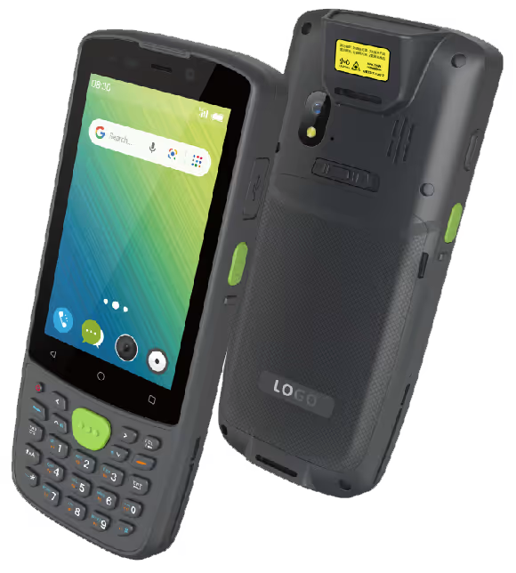
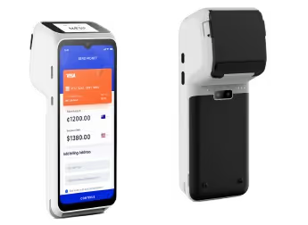
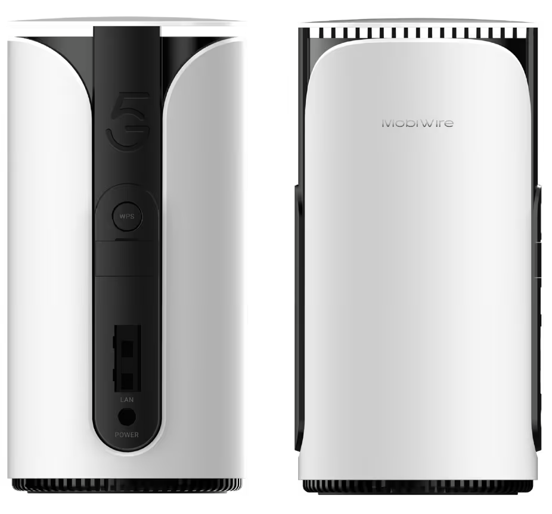
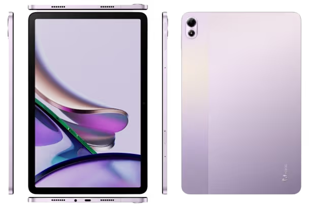

# MobiWire

**A global ODM partner for high-compliance AI hardware.**

We take hardware from concept to production, with local project teams across the US, EU, and Asia.

[Website](https://mobiwire.com/us) · [Products](https://mobiwire.com/us/products) · [News](https://mobiwire.com/us/news) · [Careers](https://mobiwire.com/us/careers) · [Talk to us](https://mobiwire.com/us/contact)

| 36M | 1,500+ | 90+ | 6.6M |
|:---:|:---:|:---:|:---:|
| devices shipped in 2025 | in-house engineers | countries shipped to | units a month, full production capacity |

## What we build

|  |  |  |  |
|:---:|:---:|:---:|:---:|
| 4" rugged PDA with 4G and barcode scanner | 6.56" smart POS with 4G and integrated printer | 5G CPE with Wi-Fi 6 | 10.95" ultra-thin 4G tablet |

Hardware for high-compliance industries:

| Industry | What we make |
|---|---|
| **Consumer** | Feature phones, smartphones, tablets, routers, and accessories |
| **Fintech & Payments** | Handheld and tabletop POS, SoftPOS, and Tap-to-Pay solutions |
| **Know Your Customer** | Smart devices for customer enrollment and SIM registration |
| **Industrial** | Handhelds, scanners, and logistics hardware |
| **Medical & Healthcare** | Terminals, medical devices, and biometric devices |
| **Automotive** | Infotainment, telematics, sensors, and vehicle communications |
| **Aerospace** | Drones, avionics, and airborne communications |

## Every layer of the stack

Developed in-house by our 1,500+ engineers.

- **Cellular and 5G:** in-house RF from 2G through 5G, with carrier approvals across four continents.
- **AI compute:** NPUs from 3 to 200+ TOPS, with deployment-ready firmware.
- **Connectivity:** Bluetooth, NFC, UWB, Wi-Fi, NB-IoT, LoRa, and digital RF radios.
- **Payments:** PCI PTS and EMVCo L1 contactless, with secure element integration for NFC and tap-to-pay.
- **Android and OS:** OS customization, application software development, and GMS certification.
- **Biometrics and security:** fingerprint, facial recognition, and iris integration.

## How we work

ODM, JDM, EMS, and White-Label, from your first call through mass production.

Quality: under 1% device failure, over 96% on-time delivery, 450 people in quality, and 100+ tests in our in-house lab.

Certifications include ISO 9001, ISO 13485, ISO 14001, ISO 27001, and IATF 16949.

## Where we are

| Location | Site |
|---|---|
| Paris, France | Group headquarters |
| Boston, USA | US Customer Solutions and growth team |
| Ningbo, China | MobiWire Park: factory, quality, and R&D |
| Brașov, Romania | European factory |

## Code on GitHub

We have not published product code here yet. Anything we release will appear in this organization, with its license and contribution guidelines in the repository.

## Talk to us

For product and partnership questions, please [contact our team](https://mobiwire.com/us/contact) or email github-it@mobiwire.com for anything about this GitHub organization. You can also find us on [LinkedIn](https://www.linkedin.com/company/mobiwire/) and [YouTube](https://www.youtube.com/@MobiwireGroup).

Copyright © 2026 MobiWire. All rights reserved.
