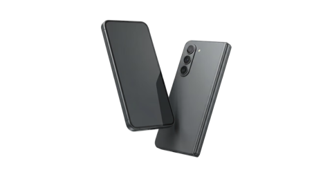
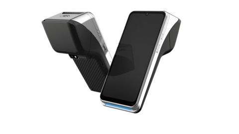
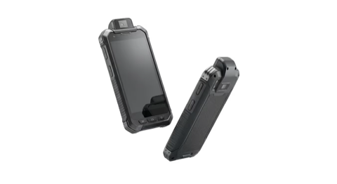
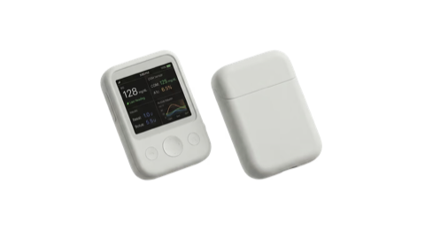
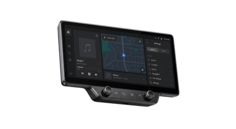
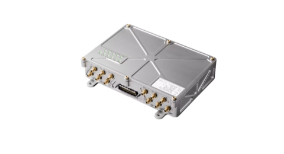

# MobiWire

**A global ODM partner for high-compliance AI hardware.**

We take hardware from concept to production, with local project teams across the US, EU, and Asia. On software, we are experts in Android, and we also provide Linux, Debian, and Yocto OS-based BSPs for edge AI hardware.

[Website](https://mobiwire.com/us) · [Talk to us](https://mobiwire.com/us/contact) · github-it@mobiwire.com

| 36M | 1,500+ | 90+ | 6.6M |
|:---:|:---:|:---:|:---:|
| devices shipped in 2025 | in-house engineers | countries shipped to | units a month, full production capacity |

## Software we build

| Area | What we do |
|---|---|
| **Android** | OS customization, application software, and GMS certification |
| **Debian** | BSPs for edge AI hardware |
| **Yocto** | BSP layers for edge AI hardware |
| **Linux** | Board support and OS images for our hardware |
| **Edge AI** | Deployment-ready firmware for NPUs from 3 to 200+ TOPS |
| **Connectivity** | Software for cellular and 5G, Wi-Fi, Bluetooth, and NFC |

## Hardware we build

| Vertical | What we make | |
|---|---|---|
| **Consumer** | Feature phones, smartphones, tablets, routers, and accessories |  |
| **Fintech & Payments** | Handheld and tabletop POS, SoftPOS, and Tap-to-Pay solutions |  |
| **Industrial** | Handhelds, scanners, and logistics hardware |  |
| **Medical & Healthcare** | Terminals, medical devices, and biometric devices |  |
| **Automotive** | Infotainment, telematics, sensors, and vehicle communications |  |
| **Aerospace** | Drones, avionics, and airborne communications |  |

## Code on GitHub

We have not published product code here yet. Anything we release will appear in this organization, with its license and contribution guidelines in the repository.

Copyright © 2026 MobiWire. All rights reserved.
